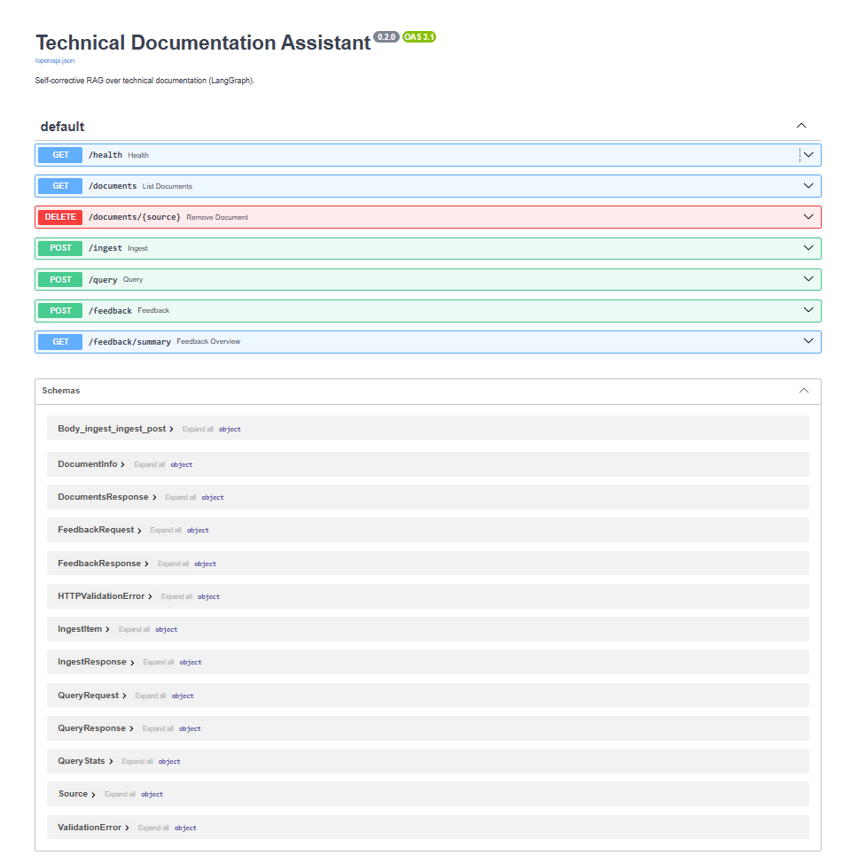
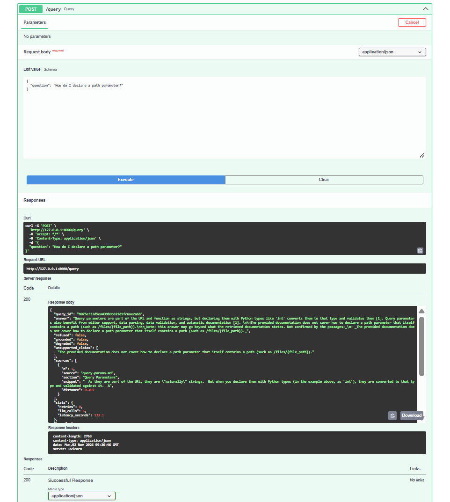
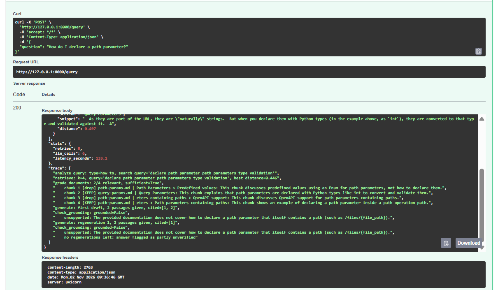
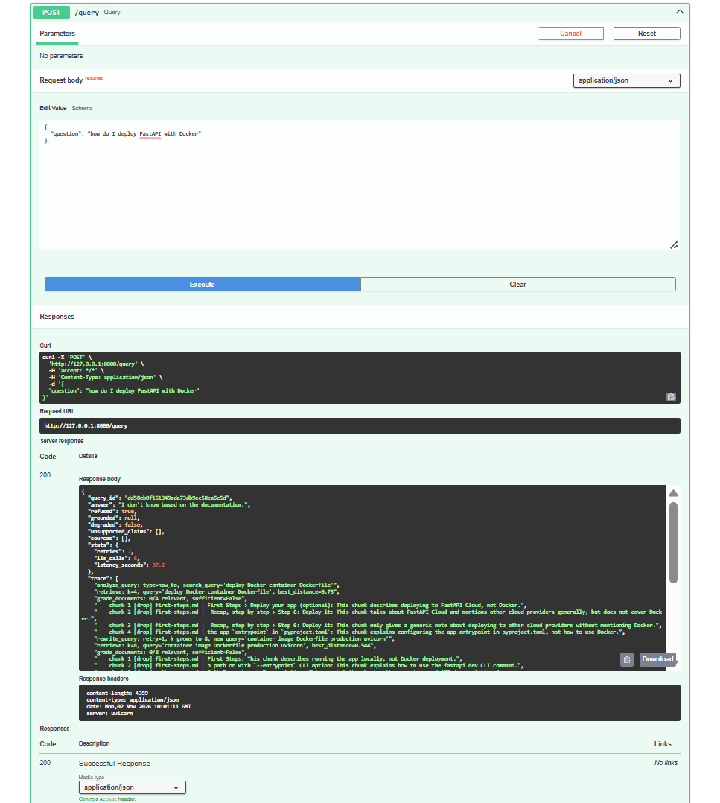
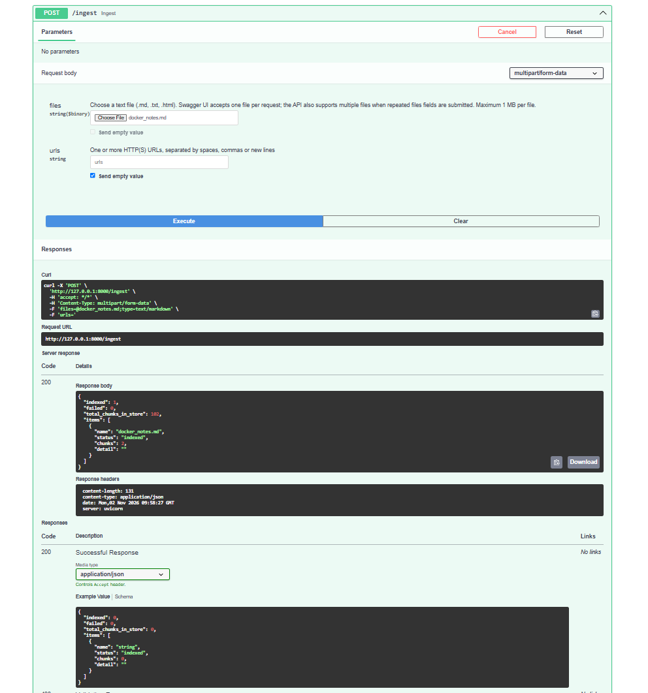
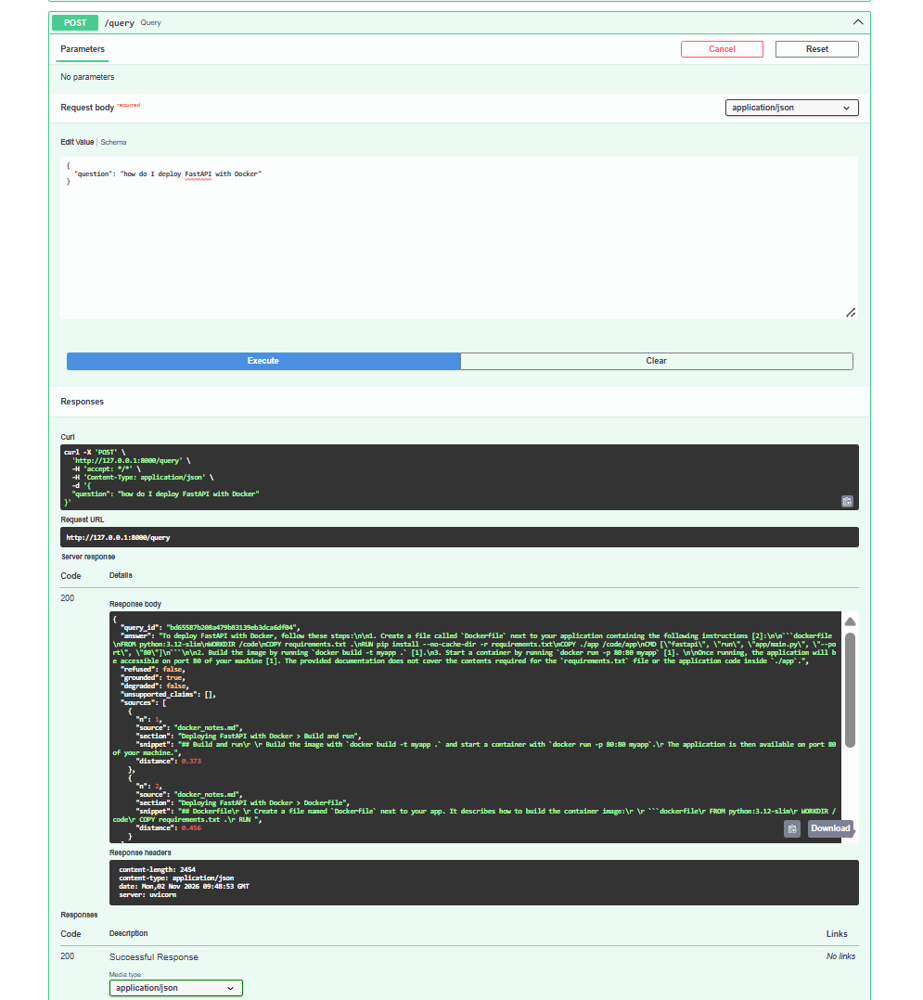
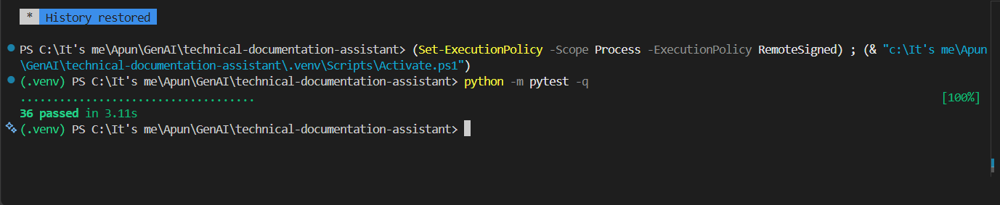
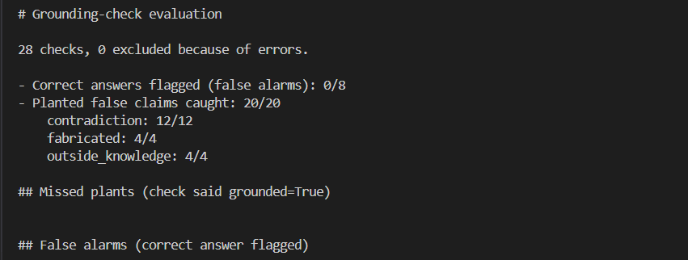
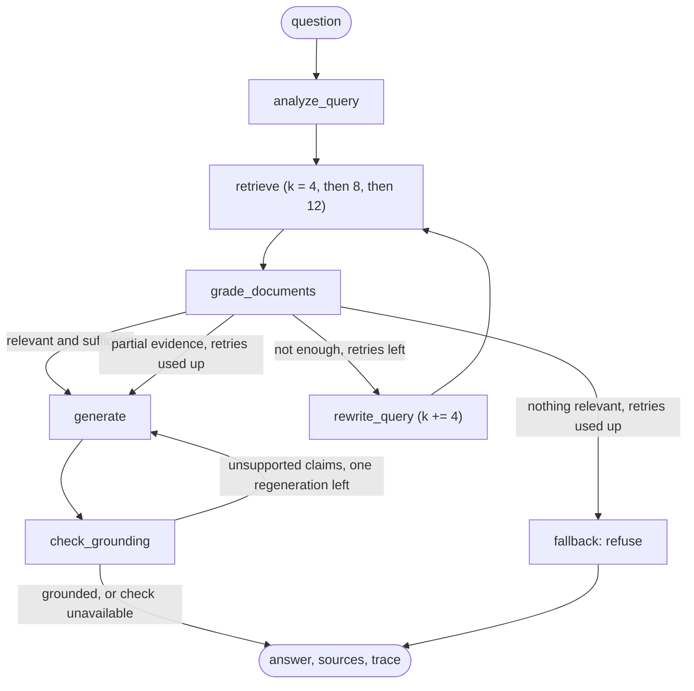

# Technical Documentation Assistant

A retrieval-augmented question-answering system over technical documentation, built as a **self-corrective LangGraph workflow** and served with **FastAPI**. It retrieves chunks, has an LLM grade them, rewrites the query and retries when the evidence is weak, writes an answer with citations, and verifies that the answer is supported by the retrieved text. When the documentation does not contain the answer, it says so.

The demo corpus is five pages of the FastAPI tutorial (first steps, path parameters, query parameters, request body, handling errors). `scripts/fetch_docs.py` downloads them, so the corpus is reproducible.

**Provider note:** every model call goes through one function (`app/llm.py`), and the provider and model are chosen in `.env`. The system was developed on `openai/gpt-oss-120b` via Groq and also evaluated on `gemini-3.5-flash-lite`.

---

## Tech stack

| Layer | Technology | Used for |
|---|---|---|
| Language | Python 3.11 | Everything |
| Workflow | LangGraph (`StateGraph`) | Nodes, shared state, conditional edges, the retry loop |
| LLM framework | LangChain (core, text splitters) | Prompts, structured output, document objects, chunking |
| LLM providers | Groq (`openai/gpt-oss-120b`), Google Gemini (`gemini-3.5-flash-lite`) | Query analysis, grading, rewriting, generation, grounding check |
| Embeddings | sentence-transformers `all-MiniLM-L6-v2` (via `langchain-huggingface`) | Local 384-dimension embeddings, no API cost |
| Vector store | ChromaDB (via `langchain-chroma`) | Persistent similarity search with cosine distance |
| API | FastAPI, Uvicorn, Pydantic v2, pydantic-settings, python-multipart | Endpoints, validation, settings, file uploads |
| Data storage | SQLite (standard library) | Query log and user feedback |
| Ingestion | requests, BeautifulSoup4, markdownify | Fetching pages, converting HTML to Markdown, SSRF-checked URL ingestion |
| Testing | pytest, httpx (FastAPI TestClient) | 36 tests with a fake LLM and fake vector store |
| Diagrams and tooling | Mermaid, Git and GitHub, VS Code | Architecture diagram, version control |

## Screenshots

**Interactive API (`/docs`)**



**An answer with citations and grounding status**



**The trace shows the self-correction: the first retrieval is rejected, the query is rewritten, `k` grows, and the right chunk is kept**



**A question the documentation does not cover is refused**



**Uploading a document in the browser (`/upload`), then asking the same question again**





**Tests and grounding-check evaluation**





## 1. Architecture



| Node | What it does |
|---|---|
| `analyze_query` | An LLM classifies the question (conceptual, how_to, troubleshooting, api_reference) and writes a search query that uses the documentation's vocabulary. |
| `retrieve` | Similarity search in ChromaDB. Returns the chunks with their source, section and distance. |
| `grade_documents` | One batched LLM call returns a relevant/irrelevant verdict **and a reason for every chunk**, plus a `sufficient` flag: do the kept chunks together answer the question? |
| `rewrite_query` | Writes a new query that differs from all earlier ones, using the grader's reasons. Increases `k` by 4. |
| `generate` | Writes the answer from the numbered passages only, with `[n]` citations. Told when the evidence is partial. |
| `check_grounding` | A second LLM call checks every claim and code example against the passages (inspired by Self-RAG). Unsupported claims trigger one regeneration, then a visible note listing them. |
| `fallback` | Returns "I don't know based on the documentation." |

### State schema

The state is the contract between nodes (`app/graph/state.py`).

| Field | Purpose |
|---|---|
| `question` | The user's original words. Grading and answering always use this, so a rewritten query cannot drift from what the user meant. |
| `search_query`, `tried_queries` | What is searched (may be rewritten); an append-only list so the rewriter never repeats itself. |
| `top_k` | Grows on every retry (4, 8, 12). Evidence that this is needed is in section 6. |
| `retry_count` | Counts rewrites. The router stops at `max_retries` (2), so at most three retrievals. |
| `documents`, `relevant_documents` | Everything retrieved, and only what passed grading. Kept apart so the trace can show what was filtered out. |
| `grading_feedback`, `context_sufficient` | The grader's reasons and its sufficiency verdict. |
| `answer`, `sources`, `generation_attempts`, `generation_failed` | Output and the regeneration counter. |
| `grounded`, `unsupported_claims` | `True` / `False` / `None` (`None` means not verified: refusals, or the check itself failed). |
| `trace` | Append-only log (a reducer) written by every node and returned by the API. |

### Routing

* After grading: answer if there is relevant and sufficient evidence; otherwise rewrite and retry; once retries are used up, answer from partial evidence if any exists, else refuse.
* After generation: if the LLM call failed, end with an error. Otherwise check grounding.
* After the check: regenerate at most `max_regenerations` (1) time, then return the answer with a note naming the unconfirmed claims.

### Failure behaviour

LLM output is unreliable, so every node has a defined behaviour when a call fails (`_call` in `app/graph/nodes.py`): analysis falls back to the original question; grading **fails closed** (nothing is trusted); the rewrite still increments the retry counter so the loop always ends; a failed grounding check returns `grounded: null` rather than claiming verification. The API sets `degraded: true` if any node failed, or if an answer was produced without a grounding-check record, so an outage cannot pass for a normal "I don't know".

---

## 2. Quick start

Requires Python 3.10 or newer.

```bash
git clone https://github.com/Optimus0205/Technical-Documentation-Assistant.git
cd technical-documentation-assistant

python -m venv .venv
source .venv/bin/activate          # Windows PowerShell: .venv\Scripts\Activate.ps1
pip install -r requirements.txt
```

Create `.env` from the template and add a key:

```bash
cp .env.example .env               # Windows: copy .env.example .env
```

| Variable | Meaning |
|---|---|
| `LLM_PROVIDER` | `groq` or `gemini` |
| `LLM_MODEL` | e.g. `openai/gpt-oss-120b` (Groq) or `gemini-3.5-flash-lite` (Google). Model names change; check the provider's model list. |
| `GROQ_API_KEY` / `GOOGLE_API_KEY` | The key for the provider you chose |

Build the index and start the server:

```bash
python -m scripts.fetch_docs       # downloads the 5 pages and inlines their code examples
python -m scripts.ingest --reset   # chunks, embeds and indexes them (local embeddings, no API cost)
uvicorn app.main:app
```

Open `http://127.0.0.1:8000/docs` for the interactive API. Other useful commands:

```bash
python -m scripts.check_setup                       # verify the provider/key/model
python -m scripts.run_graph --brief "How do I declare a path parameter?"   # run one question with the full trace
python -m pytest -q                                 # 36 tests, no API calls
python -m evaluation.run_eval --repeats 2 --pause 10   # baseline vs graph evaluation
python -m evaluation.report evaluation/results/<run file>.jsonl
python -m evaluation.check_grounding --repeats 2 --pause 10   # grounding-check test with planted false claims
```

---

## 3. API

| Method | Endpoint | Purpose |
|---|---|---|
| POST | `/query` | Ask a question. Returns the answer, sources, grounding status, statistics and the trace. |
| POST | `/ingest` | Add documents: file uploads (multipart) and/or URLs. Re-ingesting a name replaces the old version. |
| GET | `/documents` | List indexed documents and chunk counts. |
| DELETE | `/documents/{source}` | Remove a document and its chunks. |
| POST | `/feedback` | Thumbs up/down plus an optional comment, tied to a `query_id`. |
| GET | `/feedback/summary` | Counts and recent thumbs-down questions (candidates for the evaluation set). |
| GET | `/health` | Status and number of indexed chunks. |

**Status codes:** 200 for answers *and* honest refusals (the request succeeded); 422 invalid input; 404 unknown `query_id` or document; 503 empty index or the LLM could not generate (retryable); 500 unexpected error (details only in the server log).

### Ask a question

```bash
curl -X POST http://127.0.0.1:8000/query \
  -H "Content-Type: application/json" \
  -d '{"question": "How do I declare a path parameter?"}'
```

(PowerShell: use the Swagger UI at `/docs`, or `Invoke-RestMethod -Uri http://127.0.0.1:8000/query -Method Post -ContentType "application/json" -Body '{"question": "How do I declare a path parameter?"}'`.)

Response (shortened; produced with `openai/gpt-oss-120b`):

```json
{
  "query_id": "ce08160bbe504490a3c64423bcd30cff",
  "answer": "Declare the parameter in the route's path and annotate it in the endpoint function:\n\n```python\n@app.get(\"/items/{item_id}\")\nasync def read_item(item_id: int):\n    return {\"item_id\": item_id}\n```\n\nThe `{item_id}` part defines the path parameter, and `item_id: int` declares its type. [1]",
  "refused": false,
  "grounded": true,
  "degraded": false,
  "unsupported_claims": [],
  "sources": [
    {
      "n": 1,
      "source": "path-params.md",
      "section": "Path Parameters > Path parameters with types",
      "snippet": "## Path parameters with types  You can declare the type of a path parameter in the function, using standard Python type annotations...",
      "distance": 0.643
    }
  ],
  "stats": {"retries": 1, "llm_calls": 6, "latency_seconds": 9.2},
  "trace": [
    "analyze_query: type=how_to, search_query='declare path parameter'",
    "retrieve: k=4, query='declare path parameter', best_distance=0.458",
    "grade_documents: 0/4 relevant, sufficient=False",
    "    chunk 1 [drop] path-params.md | Path Parameters > Predefined values: Discusses predefined values for path parameters, not how to declare them.",
    "rewrite_query: retry=1, k grows to 8, new query='Path(...) parameter declaration in route function'",
    "retrieve: k=8, query='Path(...) parameter declaration in route function', best_distance=0.492",
    "grade_documents: 1/8 relevant, sufficient=True",
    "generate: first draft, 1 passages given, cited=[1]",
    "check_grounding: grounded=True"
  ]
}
```

The first retrieval returned only advanced sub-sections, the grader rejected all four, the rewrite widened the search to eight chunks, and the chunk that actually answers the question was found. The trace makes this visible.

A question that the documentation does not cover is refused (HTTP 200):

```json
{
  "answer": "I don't know based on the documentation.",
  "refused": true,
  "grounded": null,
  "sources": [],
  "stats": {"retries": 2, "llm_calls": 6, "latency_seconds": 10.1}
}
```

Invalid input is rejected before any LLM call (HTTP 422):

```json
{"detail": [{"type": "string_too_short", "loc": ["body", "question"], "msg": "String should have at least 3 characters", "input": "hi"}]}
```

### Ingest documents

Swagger UI's file picker does not render for this endpoint, so use curl for files (URLs also work in Swagger):

```bash
curl -X POST http://127.0.0.1:8000/ingest -F "files=@examples/docker_notes.md"
curl -X POST http://127.0.0.1:8000/ingest -F "urls=https://raw.githubusercontent.com/fastapi/fastapi/master/docs/en/docs/tutorial/cors.md"
```

```json
{"indexed": 1, "failed": 0, "total_chunks_in_store": 104,
 "items": [{"name": "docker_notes.md", "status": "indexed", "chunks": 2, "detail": ""}]}
```

Accepted: `.md`, `.txt`, `.html` (converted to Markdown), at most 1 MB each, UTF-8, at most 10 files and 5 URLs per request. Each item gets its own result, so one bad file does not cancel the others.

**Demo of the whole idea** (using `examples/docker_notes.md`, a small fixture): ask "how do I deploy FastAPI with Docker" and get a refusal; ingest the file; ask again and get an answer citing `docker_notes.md`; `DELETE /documents/docker_notes.md`; ask again and get the refusal. Same code, only the corpus changed.

### Feedback

```bash
curl -X POST http://127.0.0.1:8000/feedback -H "Content-Type: application/json" \
  -d '{"query_id": "ce08160bbe504490a3c64423bcd30cff", "rating": "up", "comment": "Correct"}'
```

```json
{"query_id": "ce08160bbe504490a3c64423bcd30cff", "rating": "up", "message": "Feedback recorded. Thank you!"}
```

An unknown `query_id` returns 404; a rating other than `up`/`down` returns 422. Every `/query` is logged to a local SQLite file, which is what makes `query_id` verifiable.

---

## 4. Ingestion and chunking

**Pipeline:** load Markdown, clean it, split into chunks, embed with `sentence-transformers/all-MiniLM-L6-v2` (local, 384 dimensions), store in a persistent ChromaDB collection with cosine distance.

**Chunking strategy:** split by Markdown headings (levels 1 to 3) first, then split any long section with a recursive character splitter (800 characters, 120 overlap). Chunks under 60 characters are dropped. Every chunk keeps its `source`, `section` path and a content-hash `chunk_id`. The reasoning:

* Technical documentation is organised by headings, so a chunk should not mix two topics. A chunk covering two topics gets a blurry embedding that weakly matches many questions.
* The heading path gives readable citations such as `path-params.md > Path parameters with types`.
* A hash-based ID makes ingestion idempotent (re-running does not duplicate), and re-ingesting a file deletes its old chunks first so edited files cannot leave stale text behind.

**Chunk size experiment** (overlap 120; counts from the first version of the cleaner, so only the trend matters): 500 characters gave 127 chunks and fragmented explanations from their examples; 1200 gave 71 and began mixing topics (a heading note and two unrelated warnings in one chunk); 800 gave 88 with mostly one idea per chunk. I chose 800 by reading chunks and counts, not by measuring retrieval, which is a limitation.

**Data problems found by inspecting real chunks** (each was invisible in "it runs" checks):

1. The documentation uses `{* ... *}` placeholders where code examples belong, so the first index had **no code**. `fetch_docs.py` now downloads each referenced example and inlines it (39 Python blocks across the five pages).
2. LangChain's `MarkdownHeaderTextSplitter` strips whitespace on every line, including inside code, which **destroyed Python indentation**. I wrote a small fence-aware splitter (`split_by_headers`) that preserves lines verbatim and does not treat `#` comments inside code fences as headings.
3. Heading anchors (`{ #section-id }`), admonition syntax (`/// note`), `<div>`, `<dfn>`, and terminal colour tags (`<font color=...>`) were cleaned. The last one was found only through an evaluation question, because answers showed `$ <font color="#4E9A06">uv run fastapi</font> dev`.

Each of these is covered by a test in `tests/test_ingestion.py`.

---

## 5. Design decisions and trade-offs

| Decision | Reason | Cost |
|---|---|---|
| Grade chunks with an LLM, not a distance threshold | Distance does not measure relevance (see section 6) | Extra LLM calls |
| One **batched** grading call (a verdict and a reason per chunk) | 1 call instead of 4 to 12; the reasons feed the rewriter and the trace | The grader sees all chunks at once; a missing verdict counts as not relevant |
| A `sufficient` verdict, not just "at least one relevant chunk" | One loosely relevant chunk used to let the graph skip the retry | More retries |
| `k` grows on each retry (4, 8, 12) | The answering chunk can rank 7th or 8th | More tokens per retry |
| Grade and answer against the original question | A rewritten query can drift | None |
| Free-text answers with `[n]` citations parsed by regex, not JSON | Code inside JSON strings is fragile | The regex must ignore code, and normalises `【1】` to `[1]` |
| Strict grounding check: "true but not in the passages" counts as unsupported | Verifiability over helpfulness | Harmless-but-true claims get flagged |
| At most one regeneration, then a visible note naming the claims | Bounded cost; honest output | An ungrounded answer can still be returned (flagged) |
| Failures fail closed and are traced; `degraded` in the API | A silent outage must not look like a correct refusal | |
| `/query` is a plain `def` | The graph blocks for seconds; `async def` would freeze the event loop | Uses a worker thread per request |
| SSRF protection for URL ingestion (resolve host, refuse non-public addresses, re-check redirects, size cap) | A server that fetches user URLs can be pointed at internal services | DNS rebinding is not covered |
| Local embeddings, local ChromaDB, SQLite | No setup or cost; reproducible | Single process (a lock guards index changes) |

---

## 6. Evaluation

### Method

17 questions: 13 answerable (each with the expected source file and a must-include keyword) and 4 that the corpus cannot answer. Both systems were run twice per question, where the baseline is a plain "retrieve 4 chunks, answer once" pipeline (`app/baseline_rag.py`, frozen as the control) and the graph is the full workflow. Correctness is a keyword check, which is crude (it can pass a wrong answer and fail a correct one), so **I read the failing answers** and adjudicated by hand. Five questions were used while developing the system and are flagged `dev`; results are reported for all questions and for the unseen ones only. Runs where a node failed (`degraded`) or the API errored are excluded and counted separately. **Results from different models are never merged**: each model is a separate experiment, because the prompts were developed on the first one.

### Results: `gemini-3.5-flash-lite` (final run, current index)

| System | Answerable: correct | Answerable: falsely refused | Unanswerable: correctly refused |
|---|---|---|---|
| baseline | 21/26 (81%) | 0/26 | 8/8 |
| graph | 24/26 (92%) | 0/26 | 8/8 |

On the 12 questions not used during development: baseline 18/20, graph 20/20.

Cost: baseline 1 LLM call, 2.6 s per question; graph 4.9 calls, 11.7 s, 0.7 retries on average. All 26 graph answers passed the grounding check. No run errored or degraded.

I read the failing answers. Baseline: q01 twice (cites the paths-containing-paths and Enum sections, no `item_id` example), q12 twice (one says the docs do not specify the mechanism although `:path` is documented; the other gives `/files/{file_path}`, which would not accept slashes), q04 once (lists the HTTP methods without the model example). Graph: q04 twice (honest but incomplete: it says the docs do not cover the code, although body.md contains an `Item(BaseModel)` example). None of the failures were checker misses. I did not read every passing answer, so the pass rates are upper bounds.


### Results: `openai/gpt-oss-120b` via Groq (earlier index and checker; free-tier rate limits)

| System | Answerable: correct | Answerable: falsely refused | Unanswerable: correctly refused |
|---|---|---|---|
| baseline | 24/26 | 1/26 | 8/8 |
| graph | 20/22 | 1/22 | 8/8 |

Cost: baseline 1 call, 2.1 s; graph 5.3 calls, 32.9 s, 0.8 retries. **14 of 44 graph runs were excluded as degraded** (rate limits) and 4 of 38 baseline runs errored, which is itself a finding: a pipeline making about 5 calls per question hits a free-tier limit sooner than one making one call. Because of that exclusion the graph has fewer counted runs, so the percentages are not measured on identical sets. Treat this table as indicative.

### What the evaluation showed

1. **Vector distance is not relevance.** For "how do I deploy FastAPI with Docker" (not in the corpus) the best distance was 0.346, *closer* than the best distance for the valid question "How do I declare a path parameter?" (0.419), because the deployment chunks are on a related topic. A threshold cannot separate "related" from "answers the question"; an LLM grader can.
2. **Retrieval rank can look right while the answer fails.** In the baseline, the right *file* ranked first for the path-parameter question, yet the chunk that answers it ranked 8th behind advanced sub-sections, and the baseline answered "I don't know". Rank at file level is too coarse a metric. The graph's retry with a wider `k` recovered the chunk in the Groq runs and in the Gemini runs, which is the situation the design targets.
3. **Accuracy was equal on `gpt-oss-120b` and higher for the graph on `gemini-3.5-flash-lite`**, at about five times the LLM calls. On Gemini the graph passed 24/26 answerable runs against 21/26 (20/20 against 18/20 on unseen questions). The difference comes from two questions (q01, q12) where the baseline's top-4 retrieval missed the chunk that answers the question and the graph's retry with a wider `k` most plausibly found it; the graph was worse on q04, where it stayed within the retrieved prose and said the docs do not cover the code example although they do. With 26 runs per system and two repetitions, a three-answer difference is suggestive, not statistically significant.
4. **Refusal behaviour depends on the model.** `gpt-oss-120b` used the exact refusal phrase; Gemini paraphrased ("the documentation does not mention Docker"). My exact-phrase checker scored those as failures until I read them, so the first Gemini table understated the baseline. The checker now also accepts a paraphrased refusal.

### Grounding check, measured with planted false claims

For four passages, one correct answer (control) and several answers with one planted false claim each (contradiction, outside knowledge, fabricated), using the real prompt and schema. On `gemini-3.5-flash-lite`: 28 checks, 0 errors; **20 of 20 planted claims flagged** (contradiction 12/12, outside knowledge 4/4, fabricated 4/4); **1 of 8 correct answers wrongly flagged**, a sentence I wrote that was not in the chunk, and the same input passed in the second repetition, so the check is not deterministic (the model ignores the temperature setting). The planted claims are mine and clear-cut, so this is an optimistic upper bound: real hallucinations are subtler. On Groq the same test completed only 17 checks before rate limits stopped it, so it is not reported as a result.

In live runs the check also caught a subtle error the first draft contained: an answer described a JSON payload as valid when the retrieved passage shows it is invalid.

### Limits of this evaluation

17 questions that I wrote (partly by reading the documents), two repetitions, a keyword-based checker, one corpus, results that vary run to run, and free-tier rate limits that shaped the Groq run. The numbers show direction, not statistical significance.

---

## 7. Problems found along the way

These are in the repository history and `notes.md` because the reasoning matters as much as the result.

* **Silent failure.** After an edit, `check_grounding` returned nothing. A LangGraph node that returns `None` is legal, so there was no error, but answers went out unverified. Found through the API response (`grounded: null`), fixed, and now guarded by a test and the `degraded` flag. Breaking the code on purpose confirmed the tests catch it.
* **Provider switch was a behaviour change, not a config change.** Gemini returns reply content as a list of blocks, not a string. The baseline crashed and the graph stored the Python repr of the list as the answer; the evaluation passes on those answers were meaningless. `text_of()` in `app/llm.py` fixes it, with unit tests; the invalid run files were quarantined, not merged.
* **Rate limits contaminated a first evaluation.** Failed LLM calls made the grader fail closed and the graph "refused", which the report counted as correct. The report now excludes degraded runs and lists them.
* **A test-design error of my own.** The first grounding false alarm came from my planted "correct" answer containing a sentence from the neighbouring chunk. I confirmed this by printing the chunk and rewrote the case.
* **Swagger UI cannot render the multipart file field** for `/ingest`; uploads are documented with curl.

---

## 8. Limitations and what I would do next

**Limitations**

* The corpus is five pages of one project; behaviour on large or multi-project corpora is untested.
* Quality was measured on a small hand-written question set with a crude checker.
* About five LLM calls per question, so latency and quota use are much higher than a plain RAG pipeline. For answerable questions that the baseline already gets right, this is wasted effort.
* Evidence from earlier retrieval rounds is discarded when a retry happens (each round's grading replaces the last).
* No authentication or rate limiting on the API; local ChromaDB means a single-process deployment; PDFs are not supported.
* The grounding check is itself an LLM and can be wrong in both directions.
* A few terminal-output samples in the index still contain HTML tags (`<u>`, `<b>`); no evaluated question was affected, and fixing it needs a re-index and a re-run.
* The graph can be too literal: on one question (q04) it answered from the retrieved prose and told the user the docs do not cover the example, which they do, because the example chunk was not kept. Grounding strictness trades helpfulness for verifiability.

**Next steps**

* Hybrid retrieval (keyword plus vector) or a reranker, and chunk text with a contextual heading header; the evidence says sub-section headings dominate the embedding, which is a hypothesis I have not tested.
* A smaller model for the helper steps (analysis, grading, rewriting, checking) and the larger one only for writing the answer, with a cost/quality evaluation.
* Merge relevant chunks across retry rounds; cache grading results; skip the loop for clearly unrelated questions (needs validation, since distance alone cannot do this).
* A larger, independently written evaluation set, with human judgement for a sample.
* Conversation memory, a simple UI, web-search fallback, Dockerfile, authentication.

## 9. Assumptions

English-language Markdown documentation; a single trusted operator (no multi-tenant isolation); provider API keys supplied by the user; free-tier quotas are enough for development; the FastAPI tutorial pages at the `master` branch are representative technical documentation.

---

## 10. Project layout

```
app/
  config.py            settings (from .env)
  llm.py               the single place that builds the chat model; text_of() helper
  vectorstore.py       embeddings + ChromaDB
  ingestion.py         cleaning, heading-aware chunking
  ingest_service.py    upload/URL validation, SSRF protection, index replacement
  baseline_rag.py      plain RAG (control group for the evaluation)
  service.py           runs the graph and shapes the API result
  storage.py           SQLite log of queries and feedback
  schemas.py, main.py  API models and endpoints
  graph/               state.py, nodes.py, routing.py, builder.py
scripts/               fetch_docs, ingest, search, run_graph, inspect/diagnose helpers
evaluation/            questions.json, run_eval.py, report.py, check_grounding.py, results/
tests/                 36 tests with fake LLM and vector store (routing, graph flow, ingestion, API)
examples/              docker_notes.md (demo fixture)
data/                  the five fetched documentation pages
notes.md               working notes: experiments, bugs, decisions
```

Tests verify the wiring (routing, retry counter, termination, status codes, parsing), not answer quality; that is what the evaluation is for.
